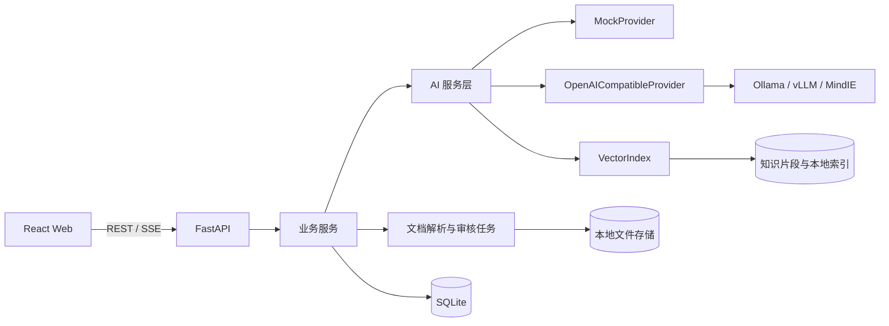

# 本地化大模型 Web Demo 设计说明

日期：2026-07-20  
状态：已完成交互式设计确认，待用户审阅书面规格  
依据：《某单位本地化大模型部署方案报告（50 万预算版，含审核与售后）》

## 1. 目标

建设一套可用于领导汇报和技术 POC 的本地化大模型 Web Demo。系统以管理驾驶舱为入口，完整演示以下三类业务：

1. 话务坐席辅助：根据来电信息和对话内容生成标准应答话术，并在通话结束后生成工单摘要。
2. 运维知识问答：从虚构的网络节点、服务器配置和变更资料中检索答案，关键结论必须带可展开的出处。
3. 文档审核：上传技术方案、设计文件或招标文件，异步生成带风险等级、原文位置、规则出处和修改建议的审核清单。

系统必须同时满足两个运行目标：

- 安全演示模式无需互联网、模型权重或外部服务，结果稳定可复现。
- 真实模型模式可连接 Ollama、vLLM、MindIE 或其他 OpenAI 兼容服务，无需修改前端或业务流程。

## 2. 非目标与业务边界

首版不实现以下能力：

- 不对接真实 CTI、电话音频或语音识别服务。
- 不对接单位 4A、CMDB、工单系统或真实网络设备。
- 不下发网络配置，不赋予模型任何设备操作权限。
- 不部署企业级 Milvus、消息队列或分布式任务平台。
- 不验证 70B 模型在昇腾硬件上的真实吞吐指标。
- 不将模型审核意见表述为正式审查结论。

首版是单用户演示系统，不设置登录页面。服务默认仅监听本机或 Docker 显式暴露的端口；生产认证、权限分库和多租户属于后续 POC 范围。

## 3. 已确认的技术路线

采用 React 与 FastAPI 前后端分离架构：

- 前端：React、TypeScript、Vite。
- 后端：FastAPI、Python、Pydantic、SQLite。
- 文件解析：pypdf、python-docx 和纯文本解析器。
- 检索：`VectorIndex` 抽象，优先使用 FAISS 本地索引；无法安装 FAISS 时使用 NumPy 余弦检索兼容实现。
- 任务执行：FastAPI 进程内受控后台执行器。任务状态持久化到 SQLite，服务重启后未完成任务标记为可重试，不伪装为完成。
- 运行方式：Windows 一键启动脚本和 Docker Compose。

### 3.1 模块边界

前端只调用 FastAPI，不直接连接模型。模型地址、模型名称和密钥不出现在浏览器构建产物中。

后端按职责划分为：

- `dashboard`：服务健康、请求统计、引用覆盖和审核任务统计。
- `call_assistant`：来电会话、话术检索、流式建议和工单摘要。
- `knowledge`：资料过滤、检索、答案生成、引用映射和无依据拒答。
- `review`：上传校验、解析、分段、规则召回、逐项检查、合并去重和结果导出。
- `providers`：模拟与真实模型统一接口。
- `retrieval`：向量索引接口、FAISS 实现、兼容回退实现和关键词降级检索。
- `audit`：记录模式切换、请求摘要、引用、任务状态和错误，不记录真实模型密钥。

模块通过 Pydantic DTO 交换数据，禁止前端依赖 Provider 的原始响应格式。

## 4. 界面与视觉设计

整体采用已确认的“管理驾驶舱 + 政务深蓝 A1”方向：深蓝侧边导航、白色内容区、蓝绿橙三种业务状态色。长文本区域保持白底和高对比度，不采用全局深色主题。

统一侧边导航包含：

1. 工作总览
2. 坐席辅助
3. 运维知识库
4. 文档审核
5. 运行与设置

### 4.1 工作总览

首页展示三类业务入口、本地服务状态、当前运行模式、今日请求数、平均响应时间、引用覆盖率和审核任务数量。指标在演示模式下来自可复现的种子数据和当前会话增量，不随机跳变。

### 4.2 坐席辅助工作台

页面采用三栏布局：客户与来电信息、当前对话记录、推荐话术与来源。用户可选择预置来电场景，也可手工输入对话。推荐话术支持流式显示、停止、复制、采纳和编辑。通话结束后生成包含诉求、处理过程、结果和后续动作的结构化工单摘要。

### 4.3 运维知识库

页面包含问题输入、系统或节点范围筛选、回答区和来源抽屉。回答中的关键结论使用引用角标；点击后显示资料名称、章节、片段、更新时间和检索相关度。知识库无可靠命中时明确拒答，不生成确定性配置结论。

### 4.4 文档审核中心

用户上传 PDF、DOCX 或 TXT 文件并选择“设计文件、技术方案、招标文件”之一。单文件上限为 20 MB。任务列表展示排队、解析、规则匹配、模型审核、汇总、完成、失败和取消状态。

完成页展示风险摘要和可筛选清单。每条意见至少包含：

- 风险等级：高、中、低。
- 问题描述。
- 原文位置和原文摘录。
- 规则名称与出处。
- 修改建议。
- 人工复核状态。

审核结果支持导出为 UTF-8 CSV。首版不生成 Word 修订稿。

### 4.5 运行与设置

页面支持安全演示模式和真实模型模式切换，展示实时队列与长文档队列状态，并提供模型连接测试。

Base URL 和模型名称可以持久化；密钥默认从后端环境变量读取。用户在页面临时输入的密钥只保存在后端进程内存中，不写入 SQLite、不回传、不写日志，服务重启后失效。

## 5. 业务数据流

### 5.1 坐席辅助

1. 用户选择预置来电场景或录入当前对话。
2. 后端根据场景标签和诉求检索审核发布的话术模板。
3. AI Provider 依据模板和对话上下文流式生成建议。
4. 前端记录首段响应时间，并允许停止、复制、采纳和编辑。
5. 用户结束通话后生成结构化工单摘要。
6. 请求模式、模板引用、采纳状态和耗时写入审计记录。

### 5.2 运维知识问答

1. 用户输入问题并选择资料范围。
2. 检索层先按资料范围过滤，再召回和排序最多 5 个片段。
3. Provider 只能基于检索上下文生成回答。
4. 后端把回答引用映射到实际资料片段。
5. 若无片段达到最低阈值，返回无依据状态和建议查询方式。
6. 前端展示答案、引用、资料更新时间和操作建议免责声明。

### 5.3 文档审核

1. 后端在创建任务前校验扩展名、MIME 类型、大小和空文件。
2. 后台任务解析文本，按标题和长度切分章节。
3. 每个章节检索相关审核规则，构建结构化检查请求。
4. Provider 返回符合固定 JSON Schema 的审核意见。
5. 后端校验结构、合并重复意见并生成汇总统计。
6. 前端轮询任务状态并展示阶段进度；任务失败时保留失败阶段和错误摘要。

## 6. 模拟与真实模型

`AIProvider` 统一提供以下能力：

- `health_check`
- `stream_call_suggestion`
- `generate_call_summary`
- `answer_with_context`
- `review_section`

`MockProvider` 根据固定样例和输入关键词返回确定性结果，并使用短暂、可配置的延迟模拟流式输出和异步审核。它不得调用互联网。

`OpenAICompatibleProvider` 支持普通聊天完成和流式聊天完成。连接配置包括 Base URL、模型名称、服务端密钥和超时。模型连接失败时，系统保留用户输入并显示重试或主动切回演示模式的选项，不得静默切换为模拟结果。

检索层规则如下：

- 演示模式使用固定维度的特征哈希向量构建本地索引，哈希种子和分词规则固定，因此无需下载嵌入模型且每次重建结果一致。
- 配置兼容的向量化接口后，可用真实向量重建索引。
- 向量接口不可用时可以明确降级为关键词检索，界面显示当前检索引擎。

## 7. 数据模型

SQLite 至少包含以下实体：

- `app_settings`：非敏感运行配置和当前模式。
- `call_sessions`：来电场景、对话、建议、摘要、采纳状态和耗时。
- `knowledge_sources`：资料元数据、范围标签和更新时间。
- `knowledge_chunks`：资料片段、位置和索引标识。
- `review_rules`：检查项、判定标准、出处、适用文档类型和风险级别。
- `review_tasks`：文件元数据、状态、阶段、进度、错误摘要和时间戳。
- `review_findings`：问题、原文位置、规则引用、建议、风险和人工复核状态。
- `audit_events`：事件类型、请求摘要、引用标识、模式、耗时、结果状态和时间戳。

上传文件存放在后端配置的数据目录中。Docker 使用具名数据卷；Windows 默认使用项目下的运行数据目录。上传文件不纳入 Git。

## 8. API 边界

首版 API 采用 `/api` 前缀，至少提供：

- `GET /api/health`
- `GET /api/dashboard`
- `GET /api/demo/call-scenarios`
- `POST /api/calls/suggestions/stream`
- `POST /api/calls/summary`
- `POST /api/knowledge/query`
- `POST /api/reviews`
- `GET /api/reviews`
- `GET /api/reviews/{task_id}`
- `POST /api/reviews/{task_id}/retry`
- `POST /api/reviews/{task_id}/cancel`
- `GET /api/reviews/{task_id}/export.csv`
- `GET /api/settings/provider`
- `PUT /api/settings/provider`
- `POST /api/settings/provider/test`
- `GET /api/audit-events`

流式话术使用 Server-Sent Events。文档审核首版使用状态轮询，避免为 Demo 引入额外的 WebSocket 生命周期复杂度。

## 9. 异常处理

- 模型不可达：保留输入，显示错误原因摘要、重试和切回演示模式操作。
- 知识库无命中：返回明确的无依据状态，不调用模型编造答案。
- 文件不支持：上传前后均校验，并提示允许的格式和大小。
- 解析无文本：任务失败在解析阶段，提示可能为扫描件；首版不内置 OCR。
- 结构化输出不合法：后端执行一次修复请求；仍失败则任务标记失败并可重试。
- 实时请求超时：允许停止并重新生成。
- 长任务取消：停止后续章节处理，已生成的中间结果不作为正式完成结果显示。
- 服务重启：运行中的审核任务标记为中断，可从任务页重新执行。

## 10. 演示数据

项目随附以下完全虚构的数据：

- 4 个来电场景：故障报修、业务咨询、服务投诉和处理结果回访。
- 12 条审核发布的话术模板。
- 6 份网络节点与服务器资料、4 条历史变更记录和必要的知识片段。
- 2 份待审样例：技术方案和招标文件。
- 24 条审核规则，覆盖完整性、一致性、技术风险和招标风险。

样例 IP 使用 RFC 5737 文档地址段或其他明确标记的非真实地址；单位、人员、设备序列号和联系方式均为虚构值。

## 11. 演示顺序

标准演示时长为 8 至 12 分钟：

1. 工作总览：展示本地化、安全状态和系统指标，约 1 分钟。
2. 坐席辅助：选择来电场景、生成话术和工单摘要，约 2 至 3 分钟。
3. 运维知识库：查询服务器或网络节点并展开出处，约 2 至 3 分钟。
4. 文档审核：提交样例、观察进度并查看风险清单，约 3 至 4 分钟。
5. 运行与设置：展示真实模型连接配置和模式切换，作为技术收尾。

## 12. 测试与验收

### 12.1 自动化测试

- 后端单元测试：Provider、检索、引用映射、文件校验、任务状态转换和结果合并。
- 后端 API 测试：健康检查、三条业务链路、设置、错误返回和 CSV 导出。
- 前端组件测试：模式状态、引用抽屉、审核进度、风险筛选和错误恢复操作。
- 端到端测试：以演示模式跑通标准演示顺序中的三条核心业务。

### 12.2 验收标准

1. Windows 一键启动和 Docker Compose 均可启动前后端。
2. 断网条件下，演示模式可完整跑通三条业务流程。
3. 真实模型设置页能测试连接、显示明确状态并切换模式。
4. 坐席话术支持流式显示、停止、复制、采纳和摘要生成。
5. 知识问答的关键结论可展开到具体资料片段；无可靠依据时拒答。
6. 文档审核展示异步阶段、风险等级、原文、规则、建议和可恢复失败状态。
7. 模型不可达、文件错误和任务失败均有明确提示与恢复操作。
8. 自动化测试全部通过，标准演示流程无未处理异常。
9. 页面在常见 1366×768 及以上桌面分辨率下无关键内容遮挡或不可操作问题。

## 13. 后续演进

进入正式 POC 后，可在不改变前端业务流程的前提下替换以下组件：

- 将本地索引替换为 Milvus 或 openGauss DataVec。
- 将进程内审核执行器替换为 Celery、RQ 或单位现有任务平台。
- 接入 4A、CMDB、工单系统和分级授权。
- 增加 OCR、Word 修订稿、规则库维护和人工复核闭环。
- 在昇腾环境中接入真实 70B 模型并执行并发与 TTFT 压测。
