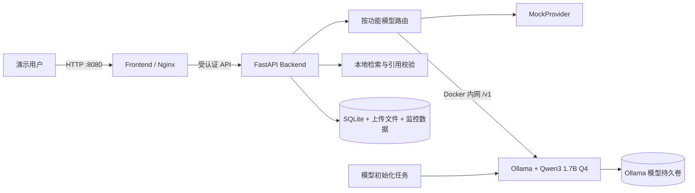

# 本地模型与综合运维知识库增强设计

日期：2026-07-22  
状态：已完成用户逐段确认，待书面复核  
目标版本：现有本地化大模型 Web Demo 的下一阶段增强

## 1. 背景与目标

当前系统已经具备真实的本地资料检索、引用校验、坐席辅助、运维知识问答、文档审核、审计和 Docker 部署能力。默认 `demo` 模式使用 `MockProvider`，输出稳定且完全离线，但最后的自然语言生成并非真实大模型推理。

本阶段在现有服务器 `76.13.220.65` 上加入真实本地模型，并把运维知识库扩展为可展示、可上传、可审核、可追溯的完整流程。最终演示应同时证明：

- 模型权重和推理均在服务器本地运行；
- 运维资料上传后经过人工审核才能参与检索；
- 回答只依据已审核资料并提供可验证引用；
- 三个业务功能可分别使用本地模型或 Mock；
- 监控页面展示真实模型状态、资源和最近 24 小时调用指标；
- 公网短期演示具有基础登录保护。

## 2. 已确认的产品决策

| 项目 | 决策 |
|---|---|
| 模型运行位置 | 当前演示服务器 |
| 运行框架 | Docker Compose 内置 Ollama |
| 生成模型 | `qwen3:1.7b-q4_K_M` |
| 硬件基线 | 2 vCPU、8 GiB 内存、无 NVIDIA GPU、支持 AVX2/AVX512 |
| 知识范围 | 网络、服务器、备份、安全、故障处置、变更管理 |
| 资料来源 | 内置资料 + TXT/PDF/Word 现场上传 |
| 入库流程 | 解析预览后人工审核通过才生效 |
| 故障降级 | 明确报错，允许人工切换 Mock；禁止静默降级 |
| 模型路由 | 坐席、知识库、审核分别配置；默认仅知识库使用本地模型 |
| 模型监控 | 完整监控页，保存最近 24 小时真实数据 |
| 访问保护 | 统一演示登录 |
| 使用规模 | 1–3 人现场演示 |
| 外网方式 | 暂时继续使用公网 IP + HTTP 8080 |

## 3. 范围与非目标

### 3.1 本阶段范围

- Ollama 和 Qwen3 的容器化安装、健康检查、持久卷和初始化拉取；
- 按业务功能独立配置本地模型或 Mock；
- 综合运维知识资料、推荐问题、上传、解析预览、审核、索引和引用；
- 知识问答的阶段状态和流式生成；
- 登录、会话、退出和基础限速；
- 模型运行状态、服务器资源、队列和 24 小时调用指标；
- 自动化测试、线上真实模型冒烟验证、部署备份和回滚。

### 3.2 非目标

- 不建设多租户、组织架构、细粒度 RBAC 或单点登录；
- 不直接连接生产网络、CMDB、监控告警或工单系统；
- 不让模型执行命令、下发配置或自动审批；
- 不开放 Ollama、SQLite、后端内部端口到公网；
- 不承诺 10 人以上并发或 GPU 级响应速度；
- 不把 HTTP 短期登录包装成正式生产安全方案；
- 不上传真实生产口令、密钥、网络地址或敏感文档。

## 4. 部署架构

Compose 新增两个服务：

- `ollama`：只加入 Compose 内网，不配置宿主机 `ports`；模型数据保存在独立持久卷；
- `model-init`：等待 Ollama 健康后执行 `ollama pull qwen3:1.7b-q4_K_M`，成功后退出。重复执行应是幂等的。

现有 `frontend` 继续对外发布 `8080:80`，`backend` 仅由 Nginx 代理访问。后端通过 `http://ollama:11434/v1` 调用 Ollama 的 OpenAI 兼容接口，不向浏览器发送模型服务地址或任何服务端凭据。

Qwen3 默认关闭思考模式，以缩短 2 核 CPU 上的演示等待。模型权重、SQLite、上传文件和监控数据在容器重建后仍保留。

## 5. 模型路由与推理队列

新增按功能持久化的模型路由配置：

| 功能键 | 默认值 | 可选值 |
|---|---|---|
| `call_assistant` | `mock` | `mock`、`local` |
| `knowledge` | `local` | `mock`、`local` |
| `document_review` | `mock` | `mock`、`local` |

配置变更流程为“构建候选配置 → 测试连接与模型存在性 → 事务保存 → 原子发布”。单个功能切换失败不能影响其他功能。业务响应和审计事件必须记录实际使用的功能键、模式、模型名称和请求 ID，但不记录输入正文。

本地推理采用进程内有界队列：

- 同时执行的本地推理数：1；
- 最大排队请求数：3；
- 单次排队加推理总超时：90 秒；
- 队列已满返回 HTTP 429 和中文可操作提示；
- 超时返回 HTTP 503，不自动改用 Mock；
- 用户取消流式请求后释放队列位置并关闭上游流。

## 6. 运维知识库

### 6.1 内置资料

提供约 30 份完全虚构但格式真实的演示资料，每类约 5 份：

1. 网络与 VLAN、路由、防火墙；
2. Linux/Windows 服务器巡检；
3. 数据库、备份与恢复；
4. 账号权限与安全基线；
5. 故障分级与应急处置；
6. 变更管理、维护窗口和回退方案。

内置资料使用保留测试地址、虚构组织名和演示参数。提供 10 个推荐问题，覆盖精确事实、跨资料归纳、范围筛选和“无可靠依据”四类演示情形。

### 6.2 资料生命周期

资料状态机：

`uploaded → parsing → pending_review → indexing → active`

终止或分支状态：`parse_failed`、`index_failed`、`rejected`、`archived`。

资料字段至少包含：标题、分类、适用范围、版本、生效日期、原始文件名、媒体类型、文件大小、内容摘要、状态、创建时间、审核时间和审核人标识。文件限制保持 20 MiB，支持 TXT、PDF 和 DOCX。

上传后自动解析与切分，但不会进入活动索引。审核页面展示：

- 文档元数据；
- 解析出的章节和片段；
- 片段序号与原文位置；
- 解析警告；
- “审核通过”“驳回”操作。

审核通过后才建立活动索引；索引失败时资料保持 `index_failed`，绝不能标记为 `active`。驳回、待审核、归档资料不参与任何检索。

### 6.3 问答数据流

1. 用户选择范围并提交问题；
2. 后端仅查询 `active` 资料；
3. 本地 NumPy/可选 FAISS 检索返回最多 4 个片段；
4. 页面先展示已命中的资料标题；
5. 后端将问题和片段发送给 Qwen3；
6. 模型回答通过 SSE 流式返回；
7. 后端只接受能映射到已检索片段的引用；
8. 无有效引用时拒绝生成结论，返回“知识库中暂无可靠依据”。

结果展示回答、模型名称、实际模式、总耗时、引用资料、章节位置、相关度和原文抽屉，并固定标识“本地模型生成，资料未离开服务器”。

## 7. 登录与短期公网保护

所有页面和业务 API 默认要求登录，仅保留登录接口和不泄露配置的精简健康检查为公开端点。

服务器环境变量：

- `DEMO_AUTH_USERNAME`：演示账号；
- `DEMO_AUTH_PASSWORD_HASH`：强密码哈希，不保存明文；
- `DEMO_SESSION_SECRET`：高熵会话签名密钥。

会话设计：

- 使用 HttpOnly、SameSite=Lax Cookie；
- 会话有效期 8 小时；
- 浏览器不把密码或会话令牌写入 localStorage；
- 同一 IP 在 10 分钟内最多失败 5 次；
- 登录、退出、失败和限速事件使用固定脱敏摘要审计；
- 修改类请求校验同源 `Origin`，降低 CSRF 风险。

因为当前选择 HTTP，不设置会导致浏览器拒绝发送的 `Secure` Cookie。页面必须固定展示短期 HTTP 演示警告；演示账号应是一次性的，不得复用服务器、邮箱或生产系统密码。正式交付前应改用域名和 HTTPS。

## 8. 本地模型监控

新增独立导航入口“本地模型监控”，只展示真实采集的数据。

### 8.1 实时状态

- Ollama 在线状态和版本；
- `qwen3:1.7b-q4_K_M` 是否已下载、是否已加载；
- 模型磁盘大小和运行位置；
- 服务器 CPU、内存、磁盘使用率；
- 当前执行数、排队数和队列上限；
- 三个功能当前使用的模式。

资源指标明确标注为“服务器整体资源”，不虚构无法安全获得的单模型 CPU 占用。禁止向后端挂载 Docker Socket；模型状态通过 Ollama API和应用自身队列获得。

### 8.2 最近 24 小时指标

- 总请求量和按功能请求趋势；
- 本地模型与 Mock 调用占比；
- 平均耗时、首字耗时和 P95；
- 成功、失败、超时、取消和 429 数量；
- 平均排队时间和最大队列深度；
- Ollama 返回时的输入/输出 token 数。

服务器资源每 10 秒采样一次。调用指标按请求写入，资源采样和调用明细超过 24 小时自动清理。监控数据只保存功能、模式、模型、耗时、状态、token 数和资源数值，不保存问题、回答、通话、文档内容或提示词。

## 9. 前端体验

### 9.1 登录页

登录页包含项目名称、短期 HTTP 安全提示、账号密码输入、登录状态和失败提示。登录成功后返回原目标页面；退出后清除会话并跳回登录。

### 9.2 运维知识库

页面增加资料管理入口、推荐问题和生成阶段：

`正在检索本地资料 → 已命中资料 → Qwen3 正在本地生成 → 流式回答完成`

上传管理页面包含资料列表、状态筛选、上传表单、解析预览、审核操作和错误重试。审核操作需要二次确认。

### 9.3 设置与监控

设置页按功能展示模式选择、当前激活状态和候选状态。本地模式启用前必须通过 Ollama/模型测试。监控页采用状态卡、24 小时折线图、功能分布和错误统计；窄屏保持可读，但主要验收视口仍为 1366×768。

## 10. 故障处理

| 故障 | 行为 |
|---|---|
| Ollama 不在线 | 显示本地模型不可用，提供重试和手动切换 Mock |
| 模型未下载 | 监控页显示初始化状态，本地推理返回 503 |
| 队列满 | 返回 429，不接受更多本地推理 |
| 推理超时 | 返回 503，记录脱敏超时指标，不自动降级 |
| 客户端取消 | 释放队列位置并关闭上游流 |
| 文档解析失败 | 保留 `parse_failed`，不进入审核或检索 |
| 审核后索引失败 | 保留 `index_failed`，不标记生效 |
| 无可靠片段 | 返回无依据响应，不调用或不采纳模型结论 |
| 引用无效 | 丢弃无效引用；无有效引用时拒绝回答 |
| 监控采集失败 | 记录采集状态，不阻塞业务功能 |
| 登录尝试过多 | 返回 429，等待限速窗口结束 |

## 11. 测试策略

### 11.1 后端

- 登录、会话过期、退出、限速、同源检查和未认证访问；
- 三功能路由独立性、配置回滚、并发快照一致性；
- 推理队列容量、排队、超时、取消和清理；
- Ollama 健康、模型缺失、结构化响应和流式中断；
- 文档状态机、解析预览、审核、索引失败补偿和归档；
- 只检索活动资料、引用映射和无依据拒答；
- 资源采样、24 小时聚合、P95、清理和内容脱敏。

### 11.2 前端

- 登录保护和返回目标页面；
- 未登录 API 统一处理；
- 知识问答阶段、流式回答、引用和错误恢复；
- 上传、预览、审核、状态筛选和失败重试；
- 按功能模式的持久状态与候选状态；
- 监控卡片、图表、空状态、错误状态和 1366×768 布局。

### 11.3 端到端与线上验收

自动化 E2E 使用可控 Ollama 替身保证结果稳定，并覆盖：

1. 登录；
2. 内置资料问答与引用；
3. 上传资料、预览、审核和新资料命中；
4. 三功能独立模式切换；
5. 监控出现刚完成的请求；
6. 本地模型不可用时的明确提示和手动 Mock 切换。

部署后另执行真实 `qwen3:1.7b-q4_K_M` 冒烟测试，确认模型下载、内部网络、热模型问答、引用、监控和容器重启持久性。线上真实模型回答不作为逐字自动断言，只断言协议、引用、状态和边界。

## 12. 验收标准

- 未登录用户无法访问业务页面或业务 API；
- Ollama 没有公网端口，浏览器无法直接访问模型服务；
- Qwen3 权重、上传资料、SQLite 和配置在容器重启后保留；
- 内置约 30 份资料和 10 个推荐问题；
- TXT/PDF/DOCX 的上传、预览、审核、索引和引用链路完整；
- 待审核、驳回、失败和归档资料不会参与检索；
- 三个功能可独立选择 `mock` 或 `local`；
- 默认仅知识库启用本地模型；
- 本地推理并发 1、最大排队 3、总超时 90 秒；
- 监控展示真实状态并保留最近 24 小时；
- 热模型知识问答在 90 秒边界内完成或给出明确可操作错误；
- 不记录密码、会话令牌、问题正文、回答正文、文档内容或提示词到监控/审计；
- 模型故障不影响仍配置为 Mock 的功能；
- 现有 8000 端口上的其他服务器应用不受影响。

## 13. 部署与回滚

部署前：

1. 导出当前提交、Compose 配置和容器状态；
2. 备份应用 SQLite 和上传文件卷；
3. 生成一次性演示账号、密码哈希和会话密钥；
4. 先启动 Ollama 和模型初始化任务，不切换现有流量；
5. 模型下载成功后执行真实内部 API 测试。

切换时构建新后端和前端容器，执行数据库兼容迁移，再重启当前项目 Compose。预计只有应用容器切换期间的短暂不可用；不得停止现有 `everlink-api` 服务。

回滚时恢复上一版 Compose 和应用数据备份。Ollama 模型卷可以保留，不影响旧版 Mock 应用；如需释放磁盘，必须另行明确确认后再删除模型卷。

## 14. 官方技术依据

- Ollama OpenAI API 兼容性：<https://docs.ollama.com/api/openai-compatibility>
- Ollama Qwen3 模型标签与大小：<https://registry.ollama.com/library/qwen3/tags>
- Qwen3 官方介绍：<https://qwenlm.github.io/blog/qwen3/>

